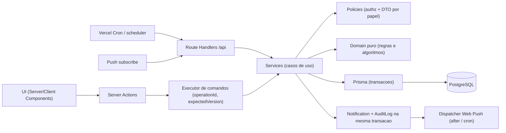
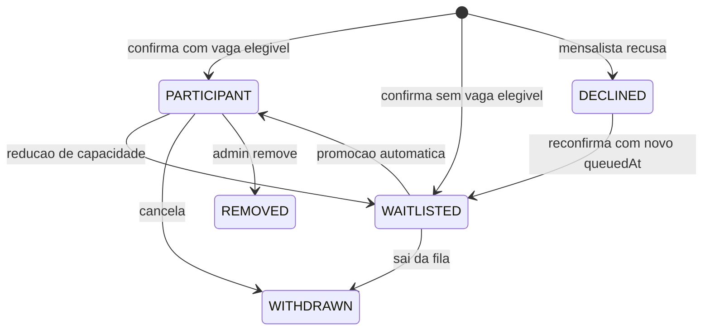
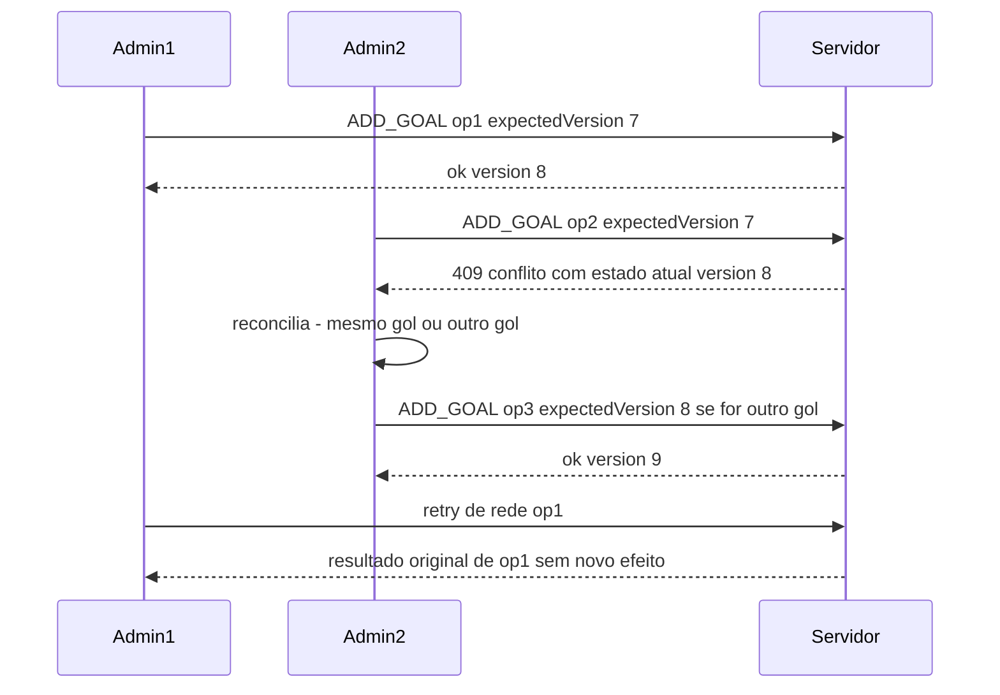
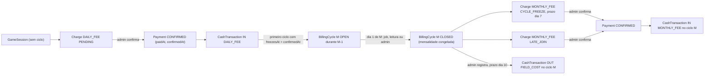
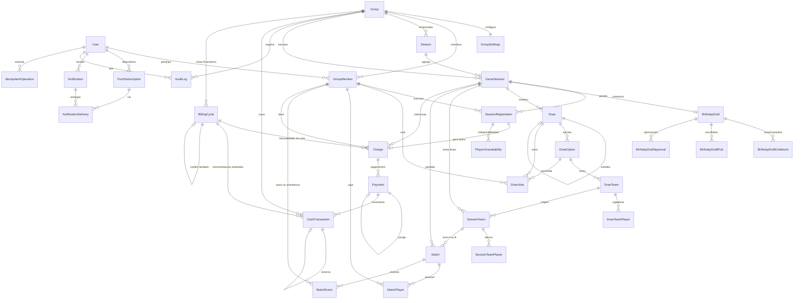

# Arquitetura - Sistema de Gestão da Pelada (Revisão 4 - planejamento estrutural encerrado)

O `PROJECT.md` continua sendo a fonte de verdade das regras. Este plano descreve como modelá-las.

- Revisão 1: seções 3, 4, 8, 11, 15, 21, 24, 25, 27, 30 e 31 do `PROJECT.md`.
- Revisão 2 (ciclo financeiro, campo mensal, mensalidade congelada, pagamento do campo): seções 4 e 31.
- Revisão 3 (arredondamento para cima, pagamento atrasado, vencimento no próprio mês, fechamento manual, saldo inicial): seção 31.
- Revisão 4 (presença real e cobrança só de PRESENT, intervenção na fila, FIXED_TEAMS/FLEXIBLE_ROTATION, criação/cancelamento de sessões, confirmações financeiras): seções 6, 11, 12, 24, 29 e 31.
- Revisão 5 (mensalidade independente da presença, capacidade na intervenção, destinatários de SESSION_CANCELLED, antecedência de 7 dias): seções 6, 11, 29 e 31.8.
- Revisão 6 (correção de presença cancela e reativa a mesma cobrança de diária): seção 31.5.
- Revisão 8 (refação do sorteio antes da primeira partida; times históricos depois dela): seção 17.
- Revisão 9 (jogador indisponível durante a sessão e empréstimo por partida no Rei da Mesa): seção 24.
- Revisão 10 (indisponibilidade temporária em períodos; conjunto de participantes congelado depois da primeira partida): seções 11 e 24.
- Revisão 11 (sorteio decidido é o oficial; sem invalidação automática; refação só manual por ADMIN antes da primeira partida): seções 11, 12 e 17.
- Revisão 12 (zero mensalistas pagantes, custo já coberto e excedente como crédito, previsão x valores congelados, diária > 0, tempo extra até 30 minutos, reason não vazio): seções 4, 20, 31.4 e 31.9.
- Revisão 13 (déficit nunca é levado adiante; crédito sempre >= 0; saldo do caixa com piso de R$ 0; saída acima do saldo é rejeitada): seções 31.9, 31.11 e 31.12.
- Revisão 14 (calendário financeiro: congelamento automático no dia 1, mensalidade até o dia 7, campo até o dia 10; diárias confirmadas no mês M reduzem a mensalidade de M+1; atribuição determinística pelo corte; mensalista que entra depois do congelamento; implantação sem histórico inventado; substitui o fechamento manual e a regra de pagamento atrasado da Revisão 3): seções 4, 31.1 a 31.3, 31.5, 31.6, 31.8 a 31.13.
- Revisão 15 (novos mensalistas só entram do dia 1 ao 7, depois da implantação): seção 31.8.
- Revisão 16 (PWA: manifest, service worker só com estáticos, página offline, layout mobile-first; push preparado, sem envio): seções 28 e 29; aqui, "PWA e Web Push" na seção 1.
- Revisão 18 (com o sorteio decidido, só o ADMIN altera a lista e a promoção é sempre manual): seções 11 e 17; aqui, "Presença e promoção automática" e "Intervenção administrativa na fila".
- Revisão 19 (o travamento começa no início da votação, ou seja, na geração do sorteio, e vale em VOTING, TIED e DECIDED; sorteio sempre do sistema, sem pré-visualização): seções 11 e 17; aqui, as mesmas subseções e "Sorteios, votação e Panela de Aniversário".
- Revisão 20 (Modo Pelada: Rei da Mesa 3/4 times, cronômetro por timestamps, placar por eventos, operationId + version): seções 21 a 24.
- Revisão 21–22 (ADMIN escolhe qualquer dois times no placar; apito finaliza confronto + timer; lista congela só no apito da 1ª; sugestão Rei da Mesa sobrescrevível): seções 21 a 24; domínio `src/domain/match`.
- Revisão 23 (Ao Vivo `/live` espectador + Encerrar sessão `SESSION_FINISHED`): navegação, polling, `getSpectatorLiveState`, `endGameSession`.
- Revisão 24 (Estatísticas/rankings a partir de MatchEvent + MatchPlayer; `/stats`).
- Revisão 25 (amb. 10–12: classificação por aproveitamento; pênaltis = V/D; goleiro fora de PJ/V/E/D).

## 1. Arquitetura da aplicação

**Recomendação: monolito modular em Next.js (App Router)**, com regras de negócio isoladas em uma camada de domínio pura (TypeScript sem Next/Prisma), uma camada de serviços (casos de uso) e a UI apenas consumindo serviços.



Estrutura de pastas sugerida:

```
src/
  app/                    # rotas, layouts, páginas (player e admin), manifest.ts
    (auth)/login, (auth)/change-password
    (app)/...             # área do jogador (rankings, caixa, sessão); app-nav.tsx
    (app)/account         # conta, troca de senha, sair, instruções de instalação
    (app)/admin/...       # área admin
    (app)/live            # Ao Vivo (espectador, PLAYER + ADMIN)
    (app)/admin/sessions/[sessionId]/live  # Modo Pelada (ADMIN)
    api/cron/[job]/route.ts
    api/push/route.ts
  domain/                 # PURO: sem imports de next/prisma; 100% testável (Vitest)
    presence/allocate.ts
    teams/strength.ts     # interface StrengthProvider
    teams/balance.ts      # gerador de opções equilibradas
    teams/partitionDistance.ts
    kingOfTheTable/rotation.ts
    stats/compute.ts
    finance/monthlyFee.ts # previsão/congelamento da mensalidade e divisão em centavos
    finance/cycleDates.ts # referência, freezesAt e prazos do ciclo; ciclo-alvo de uma diária
    schedule/sessionDates.ts
  server/
    db.ts
    auth/
    commands/             # executor idempotente + versionamento otimista
    modules/<modulo>/     # service.ts, policy.ts, schemas.ts (zod), queries.ts, dto.ts
  components/
  lib/
    pwa/config.ts         # nome, cores, URL do service worker
    pwa/service-worker-registrar.tsx
public/
  sw.js                   # service worker (JS puro, sem build)
  offline.html            # fallback sem conexão (autocontido)
  icons/                  # gerados por scripts/generate-icons.tsx (npm run icons)
```

Decisões e trade-offs:

- **Server Actions vs API REST**: Server Actions para mutações da UI e Route Handlers para cron, push e futuras integrações. Ambos chamam os mesmos services.
- **Autenticação** (decidido na Revisão 7): implementação própria, sem Better Auth, Auth.js ou OAuth. `User.passwordHash` (scrypt do `node:crypto`, N=2^17, r=8, p=1, em string PHC com os parâmetros; sem dependência nativa, e o formato permite migrar para argon2id depois com rehash no login), senha temporária individual e aleatória, `mustChangePassword`, e `AuthSession` com `tokenHash` (o cookie HttpOnly carrega o token aleatório; o banco guarda só o hash), `expiresAt`, `lastUsedAt` e `revokedAt`. A redefinição pelo admin revoga as sessões ativas. Requisitos originais, todos mantidos:
  - login só por username;
  - cadastro público desligado (contas criadas só por ADMIN);
  - admin define senha temporária;
  - flag `mustChangePassword` bloqueando o uso até a troca.
  - O `proxy.ts` faz só checagem otimista; a autorização real fica nos services.
- **Validação**: Zod nos limites; invariantes revalidadas no service dentro da transação.
- **Concorrência**: três mecanismos, conforme o caso.
  - Presença: lock da linha da sessão (`SELECT ... FOR UPDATE`).
  - Modo Pelada: versionamento otimista da Match.
  - Financeiro e Panela de Aniversário: updates condicionais por status/versão.
  - Idempotência por `operationId` para todos os comandos relevantes (seção 6).
- **Tempo real no Modo Pelada**: com vários admins operando, cada tela de admin faz polling curto (2-3s) e sempre recebe o estado mais recente (com `version`) na resposta de cada comando. A rota `/live` (espectadores autenticados) faz polling de ~2–3s via `router.refresh()` com `dynamic = "force-dynamic"`; o service worker não cacheia navegações nem dados de sessão. Pusher/Ably entram só se o polling não bastar.
- **Cronômetro**: persistir `startedAt`, `pausedAt` e `pausedTotalMs`; o tempo decorrido é calculado no cliente.
- **PWA e Web Push** (Revisão 16): sem dependências; `app/manifest.ts` + service worker manual em `public/sw.js` + Web Push com VAPID (envio ainda não implementado).
  - **Manifest**: nome e `short_name` "SMV", `display: standalone`, `start_url`, `scope` e `id` "/", `theme_color` #047857 (o mesmo do `viewport` do layout raiz). Ícones 192 e 512 em `purpose: any` e `maskable` (conteúdo dentro da zona segura), `apple-touch-icon` 180 e `favicon.ico`, todos gerados por `npm run icons` com `next/og` e versionados. O layout raiz declara `appleWebApp` (título e barra de status no iOS) e `viewportFit: cover`; o layout usa `env(safe-area-inset-*)`.
  - **Service worker**: registrado só em produção, com escopo "/" e `updateViaCache: "none"`; `/sw.js` é servido com `Cache-Control: no-cache, no-store`. Em desenvolvimento, o registrador remove registros antigos, porque os chunks do dev server não têm hash. Política de cache:
    - pré-cache: `/offline.html` e os ícones;
    - cache-first só para `/_next/static/*` (nomes com hash, imutáveis), sem query string, resposta 200 da mesma origem; o cache é podado em 300 entradas;
    - navegações: sempre rede; sem rede, `/offline.html`;
    - todo o resto passa direto (sem `respondWith`): POST e Server Actions, payloads RSC, `/api/*`, outras origens, manifest.
    - Trocar `CACHE_VERSION` apaga os caches antigos no `activate`.
  - **Dados sensíveis**: o service worker não guarda nada que dependa de usuário. As páginas logadas já saem com `Cache-Control: private, no-store` (rotas dinâmicas por usarem cookies), então também não ficam no cache HTTP. Por isso o logout não precisa limpar caches.
  - **Proxy**: o matcher ignora caminhos com extensão, então manifest, `sw.js`, `offline.html`, ícones e favicon são públicos. Nenhum deles tem dado de usuário.
  - **Navegação**: no celular, barra inferior fixa (alvos de 64px de altura); no desktop (`md`), coluna lateral com usuário e "Sair". A lista de itens é montada no servidor: o item Admin só é enviado ao cliente para ADMIN, e `/admin` continua protegido por `requireAdmin()`.
  - **Web Push, preparação** (ainda não implementado):
    - o schema já tem `PushSubscription`, `Notification` (outbox com `dedupeKey`) e `NotificationDelivery`;
    - o service worker de escopo "/" é o que receberá `push` e `notificationclick`; não haverá um segundo service worker;
    - variáveis reservadas em `.env.example`: `NEXT_PUBLIC_VAPID_PUBLIC_KEY`, `VAPID_PRIVATE_KEY` e `VAPID_SUBJECT`;
    - fluxo previsto: a tela Conta pede permissão por gesto do usuário (exigência do iOS) e chama `pushManager.subscribe` com a chave pública; uma Server Action grava `PushSubscription` (endpoint, `p256dh`, `auth`) do usuário logado. Os services criam `Notification` na mesma transação do evento; o dispatcher (`after()` ou cron) envia com VAPID, registra `NotificationDelivery` e apaga a inscrição em 404/410. No SW, `push` mostra a notificação e `notificationclick` abre a URL do payload só se for da mesma origem;
    - payload mínimo (título, texto curto, URL), sem valores financeiros (PROJECT.md, seção 29);
    - no iOS, push só funciona com o app instalado (16.4+).
- **Banco na Vercel**: Postgres gerenciado (Neon, Supabase ou Prisma Postgres) com URL pooled para runtime e URL direta para migrations.
- **Fuso horário**: `timestamptz` em UTC; `Group.timezone = America/Sao_Paulo`.
- **Dinheiro**: valores em **centavos inteiros** (`Int`). Trade-off: `Decimal` do Prisma é exato, mas devolve objetos Decimal.js incômodos na UI e nos testes. Centavos inteiros são exatos e simples. A formatação em reais fica só na apresentação.
- **Visibilidade por papel**: cada módulo expõe DTOs separados (`toPlayerDTO`/`toAdminDTO`). `baseRating`, `strengthSnapshot`, `strengthTotal` e `balanceScore` nunca saem do servidor para um PLAYER.

## 2. Domínios / módulos

- **identity**: User, login, troca de senha obrigatória, redefinição por admin.
- **group**: Group, membros (role, modalidade, nota, isenção financeira), configurações.
- **season**: temporadas.
- **gameSession**: ciclo de vida da sessão e snapshot de configuração.
- **presence**: confirmação, recusa, lista de espera, promoção automática, prazo dos mensalistas, FIXED_TEAMS/FLEXIBLE_ROTATION.
- **birthdayDraft**: Panela de Aniversário.
- **draw**: sorteios, opções (com diversidade mínima), invalidação/refação, votação.
- **teams/strength** (domínio puro): StrengthProvider, balanceamento, distância entre partições.
- **match**: times finais, partidas, participações, goleiros, eventos, Rei da Mesa, comandos concorrentes.
- **stats**: estatísticas e rankings (visíveis a todos).
- **finance** (MVP): ciclos financeiros, cobranças (diárias e mensalidades), pagamentos, movimentações de caixa (incluindo o pagamento do campo), previsão e congelamento da mensalidade, implantação. Não importa nada de presence; recebe apenas "sessão X finalizada com estes participantes diaristas".
- **notification**: inscrições push, notificações, entregas, outbox.
- **audit**: AuditLog append-only.
- **commands**: registro de idempotência e executor com versionamento.
- **scheduler**: jobs idempotentes.

## 3. e 4. Entidades, responsabilidades e relacionamentos

### Identidade e grupo

- **User**: identidade global (username, nome, `birthDate` opcional, `mustChangePassword`, `disabledAt`, `createdByUserId`). Tem 1:N GroupMember, PushSubscription e Notification.
- **AuthSession** (própria): sessões de login com `tokenHash`, `expiresAt`, `lastUsedAt`, `revokedAt`. A redefinição de senha pelo admin revoga as sessões ativas do usuário. Contas OAuth ficam para o futuro.
- **Group**: a pelada (nome, slug, timezone). Hoje tem uma única linha (seed).
- **GroupSettings** (1:1 com Group), em colunas tipadas:
  - agenda: dia da semana, início/fim, minutos extras, abertura da lista e prazo dos mensalistas (dias antes + hora);
  - formato: `maxPlayers` (20), `teamSize` (5), `matchDurationSec` (**420 = 7 min**), `drawOptionsCount` (2), `drawMinOptionDifference` (3);
  - financeiro: `dailyFeeCents` (1500, sempre > 0), `monthlyFieldCostCents` (90000, custo **mensal**), `fieldPaymentDueDay` (10), `monthlyFeeDueDay` (7), `currency` (BRL). O congelamento é sempre no dia 1 (não configurável);
  - local;
  - `sessionAutoCreateLeadDays`: com quantos dias de antecedência a sessão automática é criada.
  - Toda alteração gera AuditLog com before/after.
- **GroupMember**: vínculo User x Group com `role`, `modality`, `baseRating` (só ADMIN lê/escreve), apelido, `status`, mais **isenção financeira explícita**: `feeExempt`, `feeExemptReason`, `feeExemptUpdatedAt`. Unique (groupId, userId).
  - Trade-off da isenção: um booleano no membro é simples e o histórico fica no AuditLog. Uma tabela de períodos (`FeeExemption` com validFrom/validTo) só se justifica quando houver cobrança de mensalidade por mês. Recomendo o booleano no MVP.
  - **Papel (Revisão 28)**: `changeMemberRole` (PLAYER ↔ ADMIN) em `src/server/modules/members/service.ts`, UI em `/admin/players/[memberId]` (seção Permissões). Transação `Serializable` + `SELECT … FOR UPDATE` em todos os `GroupMember` com `role = ADMIN` do grupo ao rebaixar; recusa se o alvo é o último ADMIN **ativo**. AuditLog `MEMBER_ROLE_CHANGED` (`before.role` / `after.role`, ator e alvo no metadata). O DAL (`getViewer`) lê `role` do banco a cada request — sessões AuthSession existentes continuam válidas, mas a autorização já usa o papel novo. Não cria papéis além de ADMIN/PLAYER; não mexe em modalidade, nota, presença nem financeiro. Regressão: `npm run check:member-role`.

### Temporada e sessão

- **Season**: groupId, nome, `startsOn`, `endsOn`. Tem 1:N GameSession.
- **GameSession**: groupId, seasonId (sem `billingCycleId` desde a Revisão 14: a receita de diária é atribuída ao ciclo na confirmação do pagamento), `status`, `type`, e o **snapshot da configuração\*\*: `startsAt`, `endsAt`, `registrationOpensAt`, `priorityDeadlineAt`, `maxPlayers`, `teamSize`, `matchDurationSec`, `drawOptionsCount`, `drawMinOptionDifference`, `dailyFeeCents`. Também guarda:
  - `**origin**` (AUTOMATIC ou EXTRAORDINARY) e `scheduledFor`. Unique (groupId, scheduledFor) para AUTOMATIC, mesmo se cancelada, para que o job nunca recrie uma sessão cancelada;
  - **cancelamento**: `cancelledAt`, `cancelledByUserId`, `cancelReason`;
  - `overflowMode`, `overflowDecidedAt`, `overflowDecidedByUserId`;
  - os marcadores idempotentes `openedAt`, `priorityClosedAt`, `chargesGeneratedAt`.

### Presença

- **SessionRegistration**: uma linha por membro por sessão. Unique (sessionId, memberId). Campos:
  - fila: `status`, `queuedAt` (fato original, imutável), `**queueSortAt**` (posição efetiva; igual a `queuedAt`, salvo intervenção), `priorityTier`, `modalitySnapshot`, `source`, `respondedAt`, `**promotedAt**`, `withdrawnAt`;
  - intervenção administrativa: `manualOverrideAt`, `manualOverrideByUserId`, `manualOverrideReason` (a última; o histórico completo com before/after fica no AuditLog);
  - rotativos: `isRotating`, `rotatingSetByUserId`, `rotatingSetAt`;
  - presença real: `**attendance**` (PRESENT, ABSENT ou nulo se não marcada), `attendanceMarkedAt`, `attendanceMarkedByUserId`;
- **PlayerUnavailability** (Revisão 10): períodos de indisponibilidade temporária de um participante na sessão (lesão, saída antecipada): `sessionRegistrationId`, `startedAt`, `startedByUserId`, `reason`, `endedAt`, `endedByUserId`. No máximo um período aberto por inscrição. Não altera status, presença nem cobrança.

### Panela de Aniversário

- **BirthdayDraft** (`version`, `status`, `finalizedAt`), **BirthdayDraftCelebrant**, **BirthdayDraftPick**, **BirthdayDraftApproval** (memberId, `version`). Uma aprovação só vale para a `version` atual. Aprovar exige `expectedVersion`, o mesmo padrão otimista do Modo Pelada.

### Sorteio e votação

- **Draw**: sessionId, `sequence`, `status`, `decisionMethod`, `winningOptionId`, `seed`, `algorithmVersion`, `**minOptionDifference`** (snapshot), `**optionDistance\*\*`(distância calculada entre A e B, snapshot), dados da panela, autoria/invalidação,`replacesDrawId`.
- **DrawOption** (`label`, `balanceScore`), **DrawTeam** (`kind`, `strengthTotal`), **DrawTeamPlayer** (`strengthSnapshot`), **DrawVote** (unique drawId + voter). Os campos de força são só para ADMIN.

### Times finais, partidas e eventos

- **SessionTeam** / **SessionTeamPlayer**: times efetivos copiados da opção vencedora. Até a primeira Match da sessão são uma cópia de trabalho, substituível na refação do sorteio; depois dela são histórico (ver "Refação do sorteio e times da sessão"). SessionTeamPlayer é o time do jogador na noite e não muda com empréstimo nem com indisponibilidade (ver "Indisponibilidade e empréstimo por partida").
- **Match**: sessionId, `sequence`, `teamAId`, `teamBId`, `status`, tempos, `plannedDurationSec` (snapshot), `penaltyWinnerTeamId`, `**version`\*\* (inteiro incrementado a cada comando aceito).
- **MatchPlayer**: quem jogou cada partida (`role` FIELD/GOALKEEPER).
- **MatchEvent**: `type`, `**memberId` obrigatório\*\* (autor, para GOAL, OWN_GOAL e BIG_MISS), `teamId`, `assistMemberId` opcional (só em GOAL), `elapsedSec`, `createdByUserId`, `operationId`, campos de anulação (`voidedAt`, `voidedByUserId`, `voidReason`).

### Financeiro

- **BillingCycle** (ciclo financeiro mensal, novo na Revisão 2, calendário corrigido na Revisão 14): a mensalidade e o campo do mês `referenceMonth` (M). Fica OPEN durante M−1 acumulando diárias e é congelado no dia 1 de M.
  - identificação: groupId, `referenceMonth` (por exemplo 2026-10-01; unique por grupo), `kind` (REGULAR ou OPENING; no máximo um OPENING por grupo, índice parcial);
  - ciclo de vida: `status` (OPEN = acumulando, CLOSED = mensalidade congelada), `openedAt`, `**freezesAt**` (corte: 00:00 do dia 1 de M no fuso do grupo, snapshot na criação), `closedAt` (execução real do congelamento, CHECK `closedAt >= freezesAt`), `closedByUserId` (nulo = SYSTEM);
  - `**monthlyFeeDueDate**` (dia `monthlyFeeDueDay` de M, por exemplo 2026-10-07) e `**fieldPaymentDueDate**` (dia `fieldPaymentDueDay` de M, por exemplo 2026-10-10); CHECK: ambos dentro de M;
  - `**fieldCostSnapshotCents**` (gravado na criação a partir de `monthlyFieldCostCents`);
  - valores congelados no congelamento (nulos enquanto OPEN; a previsão do ciclo aberto é calculada, não gravada):
    - `eligibleDailyRevenueCents`: líquido de DAILY_FEE atribuído ao ciclo (pode ser negativo se o estorno de uma diária já usada num ciclo congelado cair neste ciclo);
    - `carriedCreditCents` e `carriedFromCycleId`: sobra positiva herdada do ciclo anterior (diferença de arredondamento ou excedente); sempre >= 0 (CHECK);
    - `**amountToSplitCents**` (valor exato a ser dividido) = `max(fieldCostSnapshotCents − eligibleDailyRevenueCents − carriedCreditCents, 0)`;
    - `**payingMonthlyCount**` (quantidade de pagantes, pode ser 0);
    - `**monthlyFeeCents**` (valor individual arredondado para cima; 0 sem pagantes ou com valor a dividir 0);
    - `**totalChargedCents**` (total efetivamente cobrado) = `monthlyFeeCents × payingMonthlyCount`;
    - `**roundingDifferenceCents**` (diferença de arredondamento) = `totalChargedCents − amountToSplitCents`, entre 0 e `payingMonthlyCount − 1` com pagantes; 0 sem pagantes.
  - crédito para o ciclo seguinte = `max(eligibleDailyRevenueCents + carriedCreditCents + totalChargedCents − fieldCostSnapshotCents, 0)` (= `roundingDifferenceCents` no caso normal; = excedente com o custo já coberto; 0 com zero pagantes e custo não coberto, porque déficit nunca é levado adiante). Não tem coluna própria: é derivado dos valores congelados e vira o `carriedCreditCents` do ciclo seguinte. Usa o `totalChargedCents` congelado, então cobranças LATE_JOIN não viram crédito. Os CHECKs da migration 001 garantem `carriedCreditCents >= 0`, a fórmula de `amountToSplitCents` e a relação entre mensalidade, total e diferença; a ligação com o ciclo anterior é invariante de serviço.
  - ciclo OPENING (implantação): nasce CLOSED, só com `monthlyFeeCents` declarado (>= 0); receitas, crédito, divisor, total e arredondamento ficam nulos (CHECK). `fieldCostSnapshotCents` = parte do campo do mês ainda a pagar pelo sistema. Deixa crédito 0 para o ciclo seguinte.
- **Charge** (cobrança/obrigação):
  - groupId, memberId, `type` (DAILY_FEE ou MONTHLY_FEE);
  - DAILY_FEE: `gameSessionId` e `sessionRegistrationId` obrigatórios, `billingCycleId` e `monthlyFeeOrigin` nulos (CHECK). Unique em `sessionRegistrationId` garante uma cobrança por participação;
  - MONTHLY_FEE: `billingCycleId` e `monthlyFeeOrigin` (CYCLE_FREEZE, LATE_JOIN ou OPENING) obrigatórios (CHECK). Unique (billingCycleId, memberId) para MONTHLY_FEE, via índice parcial, qualquer que seja a origem;
  - `**amountCents**` (snapshot da diária da sessão ou da mensalidade congelada do ciclo), `status`;
  - `createdByUserId` (nulo = SYSTEM), `cancelledAt`, `cancelledByUserId`, `cancelReason`.
- **Payment** (pagamento de uma cobrança): chargeId, memberId, `amountCents`, `**paidAt`** (quando o jogador pagou; CHECK `paidAt <= confirmedAt`), `**confirmedAt**`e`**confirmedByUserId\*\*`(ADMIN),`method`opcional,`notes`opcional,`status`(CONFIRMED/REVERSED),`reversedAt`, `reversedByUserId`, `reversalReason`, `correctsPaymentId`.
- **CashTransaction** (movimentação do caixa, ledger append-only):
  - groupId, `**billingCycleId**` (obrigatório: o ciclo ao qual a movimentação foi **atribuída**, gravado no momento do lançamento; para DAILY_FEE é a única ligação entre a receita e um ciclo);
  - `direction` (IN/OUT), `amountCents` (positivo), `category` (DAILY_FEE, MONTHLY_FEE, FIELD_COST, INITIAL_BALANCE);
  - `reason` (obrigatório em INITIAL_BALANCE e em estornos);
  - `occurredAt` (data real do dinheiro), `recordedAt` (em DAILY_FEE, igual a `confirmedAt`/`reversedAt` do Payment: o instante da atribuição);
  - `paymentId` (nas entradas de cobranças; nulo no pagamento do campo), `gameSessionId` (histórico por sessão);
  - `reversesTransactionId` (unique; o estorno é um lançamento da mesma categoria com direção oposta);
  - `method` e `notes` opcionais, `createdByUserId`.
- O **pagamento do campo** não ganha uma entidade própria: é um CashTransaction OUT/FIELD_COST vinculado ao ciclo. "Campo pago" é calculado comparando o líquido de FIELD_COST do ciclo com `fieldCostSnapshotCents`. Trade-off: uma entidade "conta a pagar" seria simétrica a Charge, mas com um único fornecedor e um valor por mês não acrescenta informação.

Rastreabilidade:

- GameSession → SessionRegistration (diarista PRESENT) → Charge DAILY_FEE → Payment → CashTransaction IN.
- BillingCycle → CashTransaction DAILY_FEE → Payment → Charge DAILY_FEE → GameSession.
- BillingCycle → Charge MONTHLY_FEE (CYCLE_FREEZE, LATE_JOIN, OPENING) → Payment → CashTransaction IN.
- BillingCycle → CashTransaction OUT FIELD_COST.
- BillingCycle OPENING → CashTransaction IN INITIAL_BALANCE.

O saldo do caixa nunca é armazenado; o saldo inicial é uma CashTransaction IN/INITIAL_BALANCE.

### Comandos, notificações e auditoria

- **IdempotentOperation** (novo): `operationId` (UUID, PK), groupId, `actorUserId`, `commandType`, `requestHash`, `targetType`/`targetId`, `resultJson`, `createdAt`. Gravado na mesma transação do efeito. Expurgado após N dias.
- **PushSubscription**, **Notification** (`dedupeKey` unique), **NotificationDelivery**: sem mudanças.
- **AuditLog**: sem mudanças estruturais. `metadata` passa a carregar `operationId`, `expectedVersion` e `newVersion` quando houver.

## 5. Enums

Enums no banco:

- `MemberRole`: ADMIN, PLAYER
- `PlayerModality`: MONTHLY, DAILY
- `MemberStatus`: ACTIVE, INACTIVE
- `GameSessionStatus`: SCHEDULED, OPEN, LOCKED, IN_PROGRESS, FINISHED, CANCELLED
- `GameSessionType`: NORMAL, BIRTHDAY_DRAFT
- `GameSessionOrigin` (novo): AUTOMATIC, EXTRAORDINARY
- `AttendanceStatus` (novo): PRESENT, ABSENT
- `OverflowMode`: FIXED_TEAMS, FLEXIBLE_ROTATION
- `RegistrationStatus`: PARTICIPANT, WAITLISTED, DECLINED, WITHDRAWN, REMOVED
- `PriorityTier`: MONTHLY_PRIORITY, GENERAL
- `ActionSource`: SELF, ADMIN, SYSTEM
- `BirthdayDraftStatus`: BUILDING, FINALIZED, CANCELLED
- `DrawStatus`: VOTING, DECIDED, TIED, INVALIDATED
- `DrawDecisionMethod`: VOTE, SINGLE_OPTION, ADMIN_RESOLUTION
- `DrawTeamKind`: REGULAR, BIRTHDAY, ROTATION_POOL
- `SessionTeamOrigin`: DRAW, BIRTHDAY_DRAFT, MANUAL
- `MatchStatus`: IN_PROGRESS, FINISHED, CANCELLED
- `MatchPlayerRole`: FIELD, GOALKEEPER
- `MatchEventType`: GOAL, OWN_GOAL, BIG_MISS
- `BillingCycleStatus` (novo): OPEN (acumulando diárias, mensalidade em previsão), CLOSED (mensalidade congelada; ainda recebe mensalidades e o campo)
- `BillingCycleKind` (Revisão 14): REGULAR, OPENING (mês da implantação, mensalidade declarada)
- `ChargeType`: DAILY_FEE, MONTHLY_FEE
- `MonthlyFeeOrigin` (Revisão 14): CYCLE_FREEZE, LATE_JOIN, OPENING
- `ChargeStatus`: PENDING, PAID, CANCELLED
- `PaymentStatus`: CONFIRMED, REVERSED
- `PaymentMethod` (opcional): CASH, PIX, BANK_TRANSFER, OTHER. Aqui PIX é só um rótulo da forma de pagamento, não integração.
- `CashDirection`: IN, OUT
- `CashCategory`: DAILY_FEE, MONTHLY_FEE, FIELD_COST, INITIAL_BALANCE. O estorno usa a mesma categoria com direção oposta + `reversesTransactionId`; assim o líquido por categoria é sempre Σ IN − Σ OUT.
- `NotificationType`: LIST_OPENED, MONTHLY_DECLINED, WAITLIST_PROMOTED, DAILY_PLAYERS_NEEDED, SESSION_CANCELLED
- `DeliveryStatus`: PENDING, SENT, FAILED, EXPIRED
- `ActorType`: USER, SYSTEM

Apenas em TypeScript: `AuditAction`, `AuditEntityType`, `CommandType`, `MatchOutcome`, `KingOfTheTableMode`.

## 6. Modelagem das regras críticas

### Presença e promoção automática

- Função pura `allocate(registrations, capacity, phase)` executada na transação (com lock da sessão) a cada mudança.
- **Toda liberação de vaga** (cancelamento, remoção, aumento de capacidade, prazo das 15:00) promove automaticamente o primeiro elegível da fila, sem aceite, enquanto a votação não começou (nenhum Draw ativo). Na mesma transação:
  - `status = PARTICIPANT` e `promotedAt = now()`;
  - AuditLog com actor SYSTEM;
  - Notification WAITLIST_PROMOTED no outbox.
- Elegibilidade:
  - antes do prazo, só `MONTHLY_PRIORITY` ocupa vaga;
  - depois do prazo, primeiro `MONTHLY_PRIORITY` por `queuedAt` e depois `GENERAL` por `queuedAt`. Interpretação adotada a partir do §10 do `PROJECT.md`: só perde a prioridade o mensalista que não confirmou até o prazo.
- A alocação é estável: participante só volta para a fila em caso de redução de capacidade (FIXED_TEAMS), na ordem inversa de prioridade.
- Votação iniciada (Revisões 18 e 19) = Draw ativo (`invalidatedAt IS NULL`) em VOTING, TIED ou DECIDED (`drawVotingStarted`). O Draw nasce em VOTING: gerar e abrir a votação são o mesmo comando, então não há estado "opções geradas sem votação". Com a votação iniciada, `respondToSession` rejeita qualquer comando do jogador ("Votação iniciada. Alterações na lista somente com um administrador.") e `rebalanceLockedSession` não promove nem rebaixa ninguém. Só os comandos de ADMIN mudam a lista; a promoção é o comando explícito `adminPromoteRegistration`. Ao invalidar o Draw, a alocação roda na mesma transação, antes de um eventual novo sorteio, e a fila volta a promover sozinha enquanto não houver outro Draw ativo. As verificações rodam depois do `SELECT ... FOR UPDATE` da GameSession, a mesma trava da geração do sorteio, então uma confirmação concorrente ou vem antes da votação ou é rejeitada. Teste de regressão: `npm run check:attendance-lock` (roteiro em transação desfeita, mais disputa da trava por duas conexões).
- Depois que a sessão tem qualquer Match, o conjunto de participantes fica congelado: não há liberação de vaga, promoção, inclusão nem remoção (ver "Indisponibilidade e empréstimo por partida").
- `modalitySnapshot` e `priorityTier` são gravados no momento da confirmação. A quantidade de mensalistas nunca aparece como constante; vem sempre de consulta a membros ativos.



### Intervenção administrativa na fila

- Comandos de ADMIN (`operationId`, `reason` obrigatório): incluir como participante, remover (status REMOVED) e reposicionar na fila.
- Reposicionar altera `queueSortAt` e, se necessário, `priorityTier`. Nunca altera `queuedAt`, que é o fato original.
- A função `allocate` ordena por (`priorityTier`, `queueSortAt`, id) e é estável: participante incluído pelo admin não é rebaixado por recálculos automáticos.
- Cada intervenção grava AuditLog com actor, timestamp, before/after da inscrição e reason, além dos campos `manualOverride*` na inscrição.
- Intervenções que liberam vaga (remoção) disparam a promoção automática normal, exceto com a votação iniciada: aí a vaga fica livre até o ADMIN promover alguém (`adminPromoteRegistration`: só WAITLISTED, dentro da capacidade, `promotedAt`, campos `manualOverride*`, AuditLog REGISTRATION_ADMIN_PROMOTED e WAITLIST_PROMOTED no outbox).
- Uma intervenção nunca deixa a sessão acima da capacidade efetiva. Com a sessão cheia, incluir alguém exige, no mesmo comando, remover ou reposicionar outro participante; caso contrário o comando é rejeitado.

### FIXED_TEAMS e FLEXIBLE_ROTATION (16 a 19 participantes)

- **Pré-condições do comando `setOverflowMode`** (ADMIN):
  - `priorityClosedAt` preenchido, ou seja, depois do deadline;
  - entre 16 e 19 participantes;
  - nenhum Draw ativo (não invalidado) na sessão. Isso implementa "alterável até o sorteio"; invalidar o sorteio reabre a escolha.
- **FIXED_TEAMS**: a capacidade efetiva vira 15. `allocate` devolve os excedentes para WAITLISTED na ordem inversa de prioridade (diaristas mais recentes primeiro). Eles continuam na fila e podem ser promovidos se surgir vaga.
- **FLEXIBLE_ROTATION**: a capacidade continua `maxPlayers`.
  - O ADMIN marca os rotativos (`isRotating`), com AuditLog, enquanto não houver Draw ativo (mesma pré-condição de `setOverflowMode`).
  - O sorteio só é permitido quando a quantidade de rotativos for igual a participantes − 15.
  - Os rotativos formam o bloco ROTATION_POOL, idêntico nas duas opções; o algoritmo só balanceia os 15 restantes.
  - O Draw votado, incluindo o ROTATION_POOL, é a composição oficial e nunca é reescrito: SessionTeamPlayer não é alterado depois do sorteio. Desvios práticos nas partidas ficam em MatchPlayer. Para outra composição oficial antes da primeira Match, o ADMIN usa a refação manual ("Refação do sorteio e times da sessão").
- **Voltar de FIXED para FLEXIBLE** restaura a capacidade e promove automaticamente da fila, pela regra geral de promoção.
- **Menos de 15 participantes**: nenhum comportamento automático; o sorteio automático é bloqueado. Os mecanismos disponíveis ao ADMIN são montar os times manualmente (SessionTeam com origem MANUAL) ou cancelar a sessão.

### Ciclo de vida das sessões

- **Automática**: o job `ensureUpcomingSession` cria a próxima sessão quando `registrationOpensAt − sessionAutoCreateLeadDays <= now`, com `origin = AUTOMATIC`. Usa `GroupSettings` para dia, horário, abertura (por exemplo, segunda 08:00), deadline (quinta 15:00) e os snapshots. Atribui `seasonId` e grava AuditLog com actor SYSTEM. A sessão não tem ciclo financeiro (Revisão 14).
- **Extraordinária**: comando de ADMIN com data/hora e, opcionalmente, overrides de abertura, deadline e capacidade (padrões vindos de `GroupSettings`); `origin = EXTRAORDINARY`, com AuditLog. Segue o mesmo fluxo da sessão normal.
- **Cancelamento**: comando de ADMIN (`operationId`, `reason` obrigatório), em uma transação:
  - update condicional para `status = CANCELLED` (só se não estiver FINISHED), com `cancelledAt`, `cancelledByUserId` e `cancelReason`;
  - AuditLog;
  - Notification SESSION_CANCELLED no outbox para todos os membros ativos.
  - Depois disso, jobs e services rejeitam ou ignoram a sessão: não há abertura, deadline, promoções, sorteio, votação, partidas nem cobranças. O histórico é preservado.

### Diversidade entre opções de sorteio (comparação de partições)

Uma opção é uma partição dos jogadores sorteados em blocos (times). Os rótulos dos times são arbitrários, então a comparação precisa ser invariante a permutações.

- Conjunto comparado: jogadores sorteados, excluindo a Panela de Aniversário fixa, que é idêntica nas duas opções.
- O bloco ROTATION_POOL (rotativos definidos pelo ADMIN em FLEXIBLE_ROTATION) é idêntico nas duas opções e também fica fora da comparação. Só os times REGULAR são comparados.
- Matriz de sobreposição: `M[i][j] = |P_i ∩ Q_j|` (jogadores em comum entre o time i da opção P e o time j da opção Q).
- Melhor alinhamento: `σ* = argmax_σ Σ_i M[i][σ(i)]` sobre as permutações dos times. Com até 4 times são no máximo 24 permutações, então força bruta resolve; para k maior, algoritmo húngaro.
- **Distância**: `d(P, Q) = N − Σ_i M[i][σ*(i)]`, que é o número mínimo de jogadores que precisam mudar de time para transformar P em Q. `d = 0` se e somente se as opções forem a mesma partição com outros rótulos.
- Regra: aceitar o par (A, B) somente se `d(A, B) >= drawMinOptionDifference` (snapshot, padrão 3).
- Exemplos:
  - trocar só os nomes ou cores dos times: d = 0 (rejeitado);
  - uma única troca de dois jogadores entre dois times: d = 2 (rejeitado);
  - rotação de 3 jogadores entre 3 times: d = 3 (aceito);
  - duas trocas independentes: d = 4 (aceito).
- Deduplicação rápida de candidatos: forma canônica (ids ordenados dentro de cada time, times ordenados lexicograficamente, depois hash).
- Geração: produzir um conjunto de candidatos bem equilibrados, escolher o melhor como A e o melhor B com `d(A, B) >= mínimo`. Se não existir B válido, o sorteio falha com erro explícito para o admin, sem relaxar a regra em silêncio.
- `optionDistance` é persistido no Draw para auditoria.

### Sorteios, votação e Panela de Aniversário

Sem mudanças de regra em relação à versão anterior:

- Conteúdo do Draw imutável; o Draw DECIDED é o sorteio oficial. A única mudança de estado depois disso é a invalidação por refação manual de ADMIN antes da primeira Match, com novo Draw (`replacesDrawId`) e votos do zero.
- Votação restrita a mensalistas participantes; empate fica TIED com resolução registrada pelo admin.
- Panela versionada; aprovação vale só para a versão atual.
- Telas de PLAYER mostram composição dos times e votos, nunca força.

Implementação da Fase 4 (respostas de MVP às ambiguidades 6 e 7 da seção 10):

- O ADMIN dispara o sorteio, depois do prazo dos mensalistas (`priorityClosedAt`); o sistema gera as opções com semente aleatória do servidor (`Draw.seed`). A votação abre na geração, sem pré-visualização nem escolha de opções pelo ADMIN, e trava a lista de presença para os jogadores (Revisão 19). É encerrada manualmente pelo ADMIN. Outro sorteio só existe por invalidação registrada (DRAW_INVALIDATED com ADMIN e reason; o novo Draw referencia o anterior em `replacesDrawId`).
- O voto pode ser trocado enquanto a votação está aberta (unique drawId + votante). No encerramento contam só os votos de quem ainda é elegível (PARTICIPANT, `modalitySnapshot` MONTHLY, não marcado ABSENT); os demais votos ficam registrados, mas não contam.
- Maioria simples decide (VOTE). Empate, inclusive sem votos, fica TIED; o ADMIN registra a opção decidida fora do sistema (ADMIN_RESOLUTION, reason obrigatório). `drawOptionsCount = 1` decide na geração (SINGLE_OPTION).
- Na decisão, os SessionTeam/SessionTeamPlayer são criados a partir da opção vencedora, só com quem ainda é PARTICIPANT (invariante do SessionTeamPlayer); o Draw não muda.
- Algoritmo `balance-v1` (`src/domain/draw`): reinícios aleatórios com semente (`Draw.seed`) e busca local por trocas, minimizando a diferença de força total entre times, depois a distribuição de jogadores nota 4+, depois a variância. Força = `baseRating` (`playerStrength`).
- Goleiros não entram no sorteio como categoria própria: todos os participantes são jogadores (PROJECT.md, seção 13).
- Ainda não implementados: Panela de Aniversário (sessões com panela não sorteiam), montagem manual de times com menos de 15 participantes e `operationId`.

### Refação do sorteio e times da sessão (Revisão 8)

O marco é a existência de qualquer Match na sessão, de qualquer status: a linha da Match nasce quando a partida é iniciada, e uma partida cancelada também já referenciou os times.

**Antes da primeira Match** — comando de ADMIN (`operationId`, `reason` obrigatório), em uma transação:

1. Lock da linha da GameSession (`SELECT ... FOR UPDATE`); rejeita se existir alguma Match na sessão.
2. Update condicional do Draw ativo para INVALIDATED (`WHERE id = ? AND invalidatedAt IS NULL`), com `invalidatedAt`, `invalidatedByUserId` e `invalidationReason`. Se o Draw estava DECIDED, `winningOptionId`, `decisionMethod` e `decidedAt` ficam como estavam; opções, times, jogadores e votos não são tocados.
3. Exclusão de SessionTeamPlayer e SessionTeam da sessão, se houver. É a única exclusão de linhas de negócio prevista no schema e só é válida porque nenhuma Match as usou.
4. AuditLog com o Draw invalidado, o reason e, em `before`, a composição de times substituída.
5. Criação do novo Draw (`sequence` seguinte, `replacesDrawId` = Draw invalidado) com votação do zero. Se a geração falhar (por exemplo, sem opção B com a diversidade mínima), a transação inteira é desfeita e o Draw anterior continua vigente. Os novos SessionTeam nascem somente quando esse Draw é decidido, a partir da opção vencedora.

**Sem invalidação automática** (Revisão 11): remoção, inclusão e promoção pelo ADMIN (desde o início da votação, o jogador não altera mais a lista; Revisão 19), indisponibilidade temporária, ajuste de rotativos e outras circunstâncias antes da partida NÃO invalidam o Draw. Só a refação manual acima invalida, sempre com `invalidatedByUserId` de um ADMIN (CHECK) e `reason`.

- O Draw guarda a composição do momento da geração; DrawTeamPlayer nunca é reescrito.
- Sem refação, a sessão começa com a composição oficial. Quem deixou de ser PARTICIPANT continua no SessionTeamPlayer do time oficial, mas não entra em MatchPlayer. Quem está indisponível não joga enquanto o período estiver aberto. Um participante que entrou depois do sorteio fica como participante sem time. As vagas em campo são cobertas por jogadores emprestados ou por participantes sem time, sempre via MatchPlayer.

**Depois da primeira Match**:

- criar, decidir ou invalidar Draw é rejeitado, assim como apagar ou regenerar SessionTeam;
- o comando "iniciar próxima partida" trava a mesma linha da GameSession, de modo que refação e início de partida nunca se intercalam;
- rede de segurança no banco: as FKs Restrict de `Match.teamA/teamB/penaltyWinner`, `MatchPlayer.team` e `MatchEvent.team` impedem a exclusão dos times que já jogaram, então uma regeneração completa falharia mesmo com um bug no service;
- SessionTeamPlayer nunca é apagado nem movido de time: lesão ou saída antecipada é indisponibilidade, e a vaga em campo é preenchida por empréstimo por partida (abaixo).

### Indisponibilidade e empréstimo por partida (Revisões 9 e 10)

No Rei da Mesa, quando um jogador fica indisponível, a vaga dele em campo é preenchida a cada partida por um jogador emprestado de um time que não está jogando. O emprestado continua no próprio time e volta a jogar por ele normalmente.

Exemplo: João (Time 2) se lesiona na partida 5 (Time 1 × Time 2). Marcos (Time 3, descansando) completa o Time 2. Na partida 6 (Time 2 × Time 3), Marcos joga pelo Time 3, e o Time 2 pega emprestado alguém do Time 1 ou do Time 4.

**Três camadas, nenhuma reescrita**:

- **Sorteio votado** (imutável): Draw decidido → opção vencedora → DrawTeam → DrawTeamPlayer.
- **Time do jogador na noite**: SessionTeam (`sourceDrawTeam` aponta o DrawTeam de origem) → SessionTeamPlayer, uma linha por membro na sessão, que não muda com empréstimo nem com indisponibilidade.
- **Quem jogou por qual lado em cada partida**: MatchPlayer (`teamId` = lado na partida). Emprestado = `MatchPlayer.teamId` diferente do SessionTeamPlayer do membro. O unique (matchId, memberId) já impede o mesmo jogador nos dois lados.

**Indisponibilidade temporária** (Revisão 10): **PlayerUnavailability**, um período por indisponibilidade.

- Campos: `sessionRegistrationId`, `startedAt`, `startedByUserId`, `reason` (obrigatório), `endedAt` e `endedByUserId` (nulos enquanto o jogador está indisponível).
- Voltar a ficar disponível fecha o período; ficar indisponível de novo abre outro. Nada é sobrescrito, e a sessão pode ter vários períodos por jogador.
- Índice único parcial `(sessionRegistrationId) WHERE endedAt IS NULL`: no máximo um período aberto por inscrição, garantido no banco.
- Disponível no instante t: nenhum período da inscrição com `startedAt <= t` e (`endedAt` nulo ou `endedAt > t`).

Comandos de ADMIN (`operationId`), cada um em uma transação com lock da linha da GameSession (o mesmo de "iniciar próxima partida" e da refação):

- `markUnavailable` (inscrição, `reason`): exige inscrição PARTICIPANT; insere o período com `startedAt = now()`. Um segundo período aberto é rejeitado pelo índice parcial (conflito com o estado atual). AuditLog com `reason`.
- `markAvailable` (período): update condicional `SET endedAt = now(), endedByUserId WHERE id = ? AND endedAt IS NULL`; 0 linhas = conflito. AuditLog.

Nenhum dos dois altera status, attendance, cobrança, SessionTeamPlayer nem partidas anteriores, e nenhum libera vaga: o jogador continua PARTICIPANT (e PRESENT, se compareceu). Se a lesão ocorre no meio de uma partida, João continua como MatchPlayer dela. Quando volta, joga normalmente pelo próprio time nas partidas seguintes.

Alternativas descartadas:
- campos `unavailableAt/By/Reason` na SessionRegistration (versão inicial da Revisão 9): a volta exigiria limpar ou sobrescrever os campos, perdendo o período anterior;
- tabela de eventos (indisponível/disponível): exigiria reordenar eventos para saber o estado em um instante; o período responde direto com um intervalo;
- campos em SessionTeamPlayer: a indisponibilidade é do jogador na sessão, não do time.

**Empréstimo**: não há comando nem tabela próprios. A escalação de cada partida (ao iniciar, ou pelo comando de partida que altera jogadores, com `expectedVersion` da Match) grava MatchPlayer com o lado em que cada um atua. O service valida:

- `teamId` é `teamAId` ou `teamBId`;
- o membro é PARTICIPANT e está disponível no instante em que entra na partida (`match.startedAt` na escalação inicial; o momento do comando quando entra durante a partida);
- **jogador emprestado** (tem SessionTeamPlayer, atua por outro time nesta partida): vem de um time que não está nesta partida;
- **participante sem time** (PARTICIPANT sem SessionTeamPlayer, porque entrou depois do sorteio oficial e o ADMIN não refez o sorteio): pode preencher vaga por qualquer lado; o sorteio oficial não é alterado para encaixá-lo em um time;
- um jogador por partida (unique no banco).

MatchPlayer não tem FK para SessionTeamPlayer, então os dois casos já são representáveis sem mudança de schema. As estatísticas sempre pertencem ao `memberId`.

**Conjunto de participantes congelado**: depois que a sessão tem qualquer Match, nenhum comando muda o status de uma SessionRegistration. Ficam proibidos inclusão (inclusive a intervenção excepcional), remoção, cancelamento pelo próprio jogador, promoção da fila e redução de capacidade. Quem não pode mais jogar fica indisponível; a vaga em campo é coberta só por empréstimo entre os participantes. Não há 21º participante, diarista de emergência nem promoção por lesão. É regra de service, sem mudança de schema: os comandos de presença já travam a linha da GameSession, a mesma que a criação da Match trava, então "existe Match?" é verificado sem corrida. A presença real (`attendance`) continua podendo ser marcada e corrigida, porque não muda o conjunto de participantes.

**Estatísticas**: calculadas por `memberId` a partir de MatchPlayer e MatchEvent. Gols, gols contra, assistências dadas e recebidas e pixotadas de Marcos são dele, emprestado ou não; `MatchEvent.teamId` é o lado em que ele atuou. Partida jogada, vitória, empate e derrota usam o resultado do lado `MatchPlayer.teamId`: na partida 5, Marcos soma o resultado do Time 2. Ninguém herda estatísticas de outro jogador.

**Reconstrução histórica**:

- time original de João e de Marcos: SessionTeamPlayer de cada um (e o DrawTeamPlayer da opção vencedora, via `sourceDrawTeam`);
- quando, por quem e por que João ficou indisponível, e quando e por quem voltou: os períodos de PlayerUnavailability da inscrição dele, repetidos no AuditLog;
- se João estava disponível quando a partida N começou: nenhum período cobrindo `Match.startedAt`;
- partidas que João jogou: MatchPlayer de João;
- partidas em que Marcos jogou emprestado ao Time 2: MatchPlayer de Marcos com `teamId` = Time 2, diferente do time dele (Time 3);
- partidas em que Marcos jogou pelo Time 3: MatchPlayer de Marcos com `teamId` = Time 3;
- eventos e estatísticas de cada um: MatchEvent por `memberId` (autor) e `assistMemberId`.

### Concorrência no Modo Pelada (múltiplos admins)

Comando típico:

```ts
{ operationId: uuid, matchId, expectedVersion: 7, type: "ADD_GOAL", payload: { memberId, assistMemberId?: string | null } }
```

Ordem de processamento no executor, em uma transação:

1. **Idempotência**: se `operationId` já existe em `IdempotentOperation`:

- mesmo ator e mesmo `requestHash`: devolve o `resultJson` original (duplo clique, retry de rede, reenvio);
- payload diferente: rejeita com 422.
- Essa checagem vem antes da versão, para que um retry de um comando que já teve sucesso não vire conflito falso.

2. **Versão**: `UPDATE match SET version = version + 1 WHERE id = ? AND version = expectedVersion`.

- Com 0 linhas afetadas: **conflito (409)**. Nada é gravado, nem o registro de idempotência; a resposta traz o estado atual da partida (placar, eventos, `version`).

3. **Regras**: validações de domínio. Exemplos: autor obrigatório e MatchPlayer do time; assistente do mesmo time e diferente do autor; partida IN_PROGRESS para registrar evento.
4. **Efeito**: grava o evento ou a alteração, mais `IdempotentOperation` com o resultado e AuditLog com `operationId`, `expectedVersion` e `newVersion`.
5. **Resposta**: novo estado completo da partida com a nova `version`.

Reconciliação no cliente: ao receber 409, a tela atualiza e mostra o que mudou desde a versão que o admin via (diff entre o estado local anterior e o atual; por exemplo, "Admin X registrou gol de Fulano"). O admin escolhe:

- descartar, quando era o mesmo gol;
- reenviar conscientemente, quando foi outro gol. O reenvio usa **novo operationId**, porque é uma nova decisão humana, e o `expectedVersion` atual.

Conflitos também geram AuditLog (`MATCH_COMMAND_CONFLICT`) em transação separada.

Nenhuma heurística de tempo é usada, então dois gols legítimos seguidos funcionam naturalmente: o segundo comando parte da versão que já inclui o primeiro.

Comandos que incrementam `Match.version`: iniciar, pausar, retomar e finalizar partida; adicionar, editar e anular evento; alterar jogadores ou goleiros; registrar vencedor nos pênaltis. Correções em partidas já finalizadas seguem o mesmo fluxo.

Comando no nível da sessão, "iniciar próxima partida":

- unique (gameSessionId, `sequence`);
- índice único parcial "no máximo uma partida IN_PROGRESS por sessão" (via SQL na migration);
- o comando carrega o `sequence` esperado. Se dois admins iniciarem ao mesmo tempo, o segundo recebe conflito.



O mesmo executor (`operationId` obrigatório) é usado em confirmação de presença, intervenções na fila, votação, geração de sorteio, aprovação da panela, cancelamento de sessão e comandos financeiros.

**Presença real no Modo Pelada**:

- Comando `markAttendance` (ADMIN, `operationId`) define `attendance` PRESENT ou ABSENT em uma inscrição PARTICIPANT, com AuditLog.
- Concorrência entre admins por update condicional com o valor anterior esperado: se o valor mudou, o comando recebe conflito e o estado atual.
- Se o jogador apareceu sem estar na lista, o admin primeiro o inclui (intervenção com reason) e depois marca PRESENT.

### Eventos individuais

- `memberId` obrigatório (NOT NULL) para todos os tipos. `assistMemberId` é nullable e só é aceito em GOAL.
- OWN_GOAL credita o placar do adversário (calculado).
- Correção por edição ou anulação, sempre com AuditLog e via `Match.version`.

### Financeiro



**Ciclo de vida do BillingCycle**

Linha do tempo do ciclo de outubro/2026 (M):

| Momento | O que acontece |
|---|---|
| ~01/09 | `ensureBillingCycle` cria o ciclo de outubro OPEN (`freezesAt` = 01/10 00:00 no fuso do grupo, prazos 07/10 e 10/10, snapshot do campo) |
| 01/09 a 30/09 | diárias confirmadas são atribuídas a outubro; o caixa mostra a previsão de outubro |
| 01/10 00:00 | corte: a partir daqui nenhuma diária vai para outubro, mesmo que o job atrase |
| 01/10 (job, primeira leitura/comando, ou ADMIN) | congelamento de outubro; Charges CYCLE_FREEZE pagáveis desde já; a previsão passa a ser a de novembro |
| até 07/10 | prazo das mensalidades de outubro (atraso só muda a situação exibida) |
| até 10/10 | prazo do campo de outubro (FIELD_COST no ciclo de outubro) |
| 01/10 a 31/10 | diárias confirmadas vão para novembro |

- **Criação** (job idempotente `ensureBillingCycle`, unique (groupId, referenceMonth)):
  - garante, em ordem e sem lacunas, os ciclos até o mês seguinte ao corrente (M+1 precisa existir durante M para receber as diárias);
  - cria com `status = OPEN`, `kind = REGULAR`, `openedAt`, `freezesAt` (00:00 do dia 1 do mês de referência no fuso do Group);
  - grava `fieldCostSnapshotCents` a partir de `monthlyFieldCostCents`;
  - grava `monthlyFeeDueDate` (dia `monthlyFeeDueDay`) e `fieldPaymentDueDate` (dia `fieldPaymentDueDay`) do próprio mês de referência. Se o dia não existir no mês, usa o último dia;
  - também é chamado dentro das transações que precisam do ciclo-alvo (`INSERT ... ON CONFLICT DO NOTHING`).
- **Mudança de configuração**: alterar `monthlyFieldCostCents`, `fieldPaymentDueDay` ou `monthlyFeeDueDay` vale para ciclos criados depois. Ajustar o snapshot de um ciclo OPEN é um comando explícito do admin, com AuditLog. Ciclo CLOSED nunca é alterado nem recalculado. Mudar o fuso do grupo não altera `freezesAt` de ciclos já criados.
- **Previsão dinâmica** (enquanto OPEN, sempre disponível, calculada na hora e nunca gravada; função pura `domain/finance/monthlyFee.ts`, a mesma do congelamento). A tela mostra a do ciclo OPEN mais antigo, que é a próxima mensalidade ainda não congelada:
  - `eligible` = líquido de DAILY_FEE (Σ IN − Σ OUT) com `billingCycleId` = ciclo;
  - `credit` = crédito deixado pelo ciclo anterior congelado (`max(eligibleDailyRevenueCents + carriedCreditCents + totalChargedCents − fieldCostSnapshotCents, 0)` dele; 0 se não houver ou se ele for OPENING);
  - `amountToSplit = max(fieldCostSnapshotCents − eligible − credit, 0)`;
  - `payingCount` = membros ativos, MONTHLY, `feeExempt = false`, no momento da consulta;
  - valor individual com arredondamento para cima; 0 quando `payingCount = 0` ou `amountToSplit = 0` (sem divisão por zero). Nunca negativo.
  - A tela exibe "PREVISÃO" e a fórmula com os valores reais. Os campos congelados do ciclo continuam nulos: a previsão não é o valor congelado.
- **Congelamento** (`freezeBillingCycle`, uma única função transacional e idempotente, chamada por três gatilhos: o tick no dia 1, a avaliação preguiçosa antes de qualquer leitura ou comando financeiro ou de membros, e o comando de ADMIN com `operationId` como fallback):
  1. `SELECT ... FROM "BillingCycle" WHERE id = ? FOR UPDATE`. Se já está CLOSED, devolve o resultado congelado e não faz mais nada (idempotência também para o job e para a avaliação preguiçosa).
  2. Pré-condições, com `now = clock_timestamp()` lido depois do lock:
  - `now >= freezesAt` (nunca antes do corte; também garantido pelo CHECK `closedAt >= freezesAt`);
  - o ciclo do mês anterior está CLOSED ou não existe (congelamento sequencial, garantindo que o crédito herdado já está congelado);
  - o ciclo do mês seguinte existe; se não, é criado na mesma transação, para receber as diárias confirmadas a partir do corte;
  - `payingCount = 0` é permitido: mensalidade, total e diferença ficam 0 e nenhuma cobrança é criada.
  3. Soma o líquido DAILY_FEE do ciclo (em READ COMMITTED, a consulta depois do lock enxerga todas as confirmações que seguravam o ciclo FOR SHARE), determina os mensalistas ativos não isentos e calcula com a mesma função pura da previsão.
  4. Grava `eligibleDailyRevenueCents`, `carriedCreditCents`, `carriedFromCycleId`, `amountToSplitCents`, `payingMonthlyCount`, `monthlyFeeCents`, `totalChargedCents`, `roundingDifferenceCents`, `status = CLOSED`, `closedAt = now`, `closedByUserId` (nulo = SYSTEM).
  5. Se `monthlyFeeCents > 0`, cria uma Charge MONTHLY_FEE PENDING `CYCLE_FREEZE` por pagante, todas com `amountCents = monthlyFeeCents` (nunca cobrança de valor zero; `Charge.amountCents > 0` no CHECK). O índice único (billingCycleId, memberId) impede duplicação. O conjunto das CYCLE_FREEZE é o registro explícito de quem formou o divisor.
  6. Grava AuditLog (actor SYSTEM ou o ADMIN) com o cálculo completo e a lista de pagantes.
  - Vários ciclos atrasados (sistema parado por meses) são congelados em ordem, um por transação.
  - Depois de CLOSED, o ciclo continua recebendo pagamentos de mensalidade, inclusive LATE_JOIN, e o pagamento do campo, sem alterar os valores congelados; nunca mais recebe lançamentos DAILY_FEE.
- **Novo mensalista** (Revisão 15; cobrança LATE_JOIN): depois da implantação, o comando que cria um membro MONTHLY ou muda um diarista para MONTHLY só é aceito do dia 1 ao dia `monthlyFeeDueDay` (7) do mês, no fuso do grupo; fora disso é rejeitado. Na mesma transação, depois da avaliação preguiçosa:
  - trava o ciclo do mês corrente `FOR SHARE`. Se ele ainda está OPEN (congelamento pendente), o congelamento espera este commit e conta o membro no divisor. Se está CLOSED (caso normal), cria a Charge MONTHLY_FEE `LATE_JOIN` com `amountCents = monthlyFeeCents` congelado;
  - não cria se `monthlyFeeCents = 0` nem se já existe mensalidade do membro no ciclo (índice parcial);
  - não altera nenhuma coluna do ciclo nem as outras cobranças. O pagamento entra no ciclo da cobrança e aumenta o caixa, mas o crédito do ciclo seguinte usa o `totalChargedCents` congelado, então esse dinheiro não reduz a próxima mensalidade.
  - Nenhum outro caminho cria LATE_JOIN.
- **Implantação** (`initializeFinance`, ADMIN, `operationId`, uma transação, uma única vez por grupo): ver "Implantação" abaixo.

**Arredondamento da mensalidade** (decidido): valor igual para todos, arredondado para cima ao centavo.

- Em inteiros: `monthlyFeeCents = ceil(amountToSplitCents / payingMonthlyCount)`, calculado como `floor((amountToSplitCents + payingMonthlyCount − 1) / payingMonthlyCount)`, sem ponto flutuante.
- Exemplo: 82500 / 19 → 4343. Total cobrado: 82517. Diferença: 17.
- Os 17 centavos ficam no caixa (o total cobrado é maior que o necessário) e entram como `carriedCreditCents` no ciclo seguinte, reduzindo o valor a dividir. Assim o excedente beneficia o próximo ciclo sem ser descartado nem contado duas vezes.
- Custo já coberto (Revisão 12): com diárias 95000, crédito 0 e campo 90000, `amountToSplitCents = 0`, mensalidade 0, nenhuma cobrança, e a sobra de 5000 vira o `carriedCreditCents` do ciclo seguinte.

**Atribuição de movimentações ao ciclo** (sempre gravada em `CashTransaction.billingCycleId`, nunca derivada da data):

- **Pagamento de diária** (Revisão 14): ciclo-alvo = o ciclo de menor `referenceMonth` com `freezesAt > confirmedAt`. Como `paidAt <= confirmedAt` (CHECK), uma diária recebida ou confirmada no mês M nunca reduz a mensalidade de M. Exemplos: recebida e confirmada em setembro → outubro; recebida em 30/09 e confirmada em 01/10 09:00 → novembro, mesmo que o job de outubro ainda não tenha rodado; sessão de setembro paga em outubro → novembro.
- Protocolo da confirmação (determinístico; o lock só garante que o congelamento enxergue exatamente as diárias anteriores ao corte):
  1. avaliação preguiçosa (ciclos criados e congelamentos vencidos executados) antes da transação;
  2. na transação: update condicional da Charge `PENDING → PAID`; escolhe o alvo T pelo relógio atual, garante que existe e faz `SELECT ... FOR SHARE` em T;
  3. `confirmedAt = clock_timestamp()` lido DEPOIS do lock. Se `confirmedAt >= T.freezesAt` (o corte passou durante a espera), o alvo passa a ser o ciclo seguinte (garantido e travado FOR SHARE da mesma forma);
  4. grava Payment (`paidAt`, `confirmedAt`) e CashTransaction IN (`billingCycleId = T`, `occurredAt = paidAt`, `recordedAt = confirmedAt`) e AuditLog.
  - Por que T é sempre OPEN: o congelamento de T trava T FOR UPDATE e exige relógio >= `T.freezesAt`. Se ele tivesse terminado antes do nosso FOR SHARE, o `confirmedAt` lido depois do lock seria > `closedAt` >= `freezesAt`, e T não seria o alvo. Se ele começar depois, espera o nosso commit e inclui a diária. Uma diária nunca fica de fora de um congelamento nem entra em dois ciclos.
  - O resultado é função só de `confirmedAt` e dos `freezesAt` gravados; dá para auditar depois: `T.freezesAt > recordedAt` e o ciclo anterior tem `freezesAt <= recordedAt`.
- **Estorno de diária**: a mesma regra e o mesmo protocolo com `reversedAt` (o estorno também trava o Group pelo piso de R$ 0; ordem de locks: Group, depois ciclo). Se a diária estornada já foi usada numa mensalidade congelada, o estorno reduz a receita do ciclo OPEN da vez; o ciclo congelado não é recalculado.
- **Pagamento de mensalidade** (e estorno): sempre o ciclo da cobrança, mesmo CLOSED.
- **Pagamento do campo**: o ciclo informado pelo admin (padrão: o ciclo do mês cujo `fieldPaymentDueDate` está sendo pago).
- **Saldo inicial** (e estorno): o ciclo OPENING. Não entra na fórmula da mensalidade, que só considera DAILY_FEE e a sobra herdada do ciclo anterior.
- Nenhuma atribuição é recalculada depois de gravada. Uma movimentação por Payment (índice parcial `CashTransaction_original_per_payment_key`) e um estorno por movimentação (`reversesTransactionId` unique) impedem atribuição duplicada.

**Implantação** (grupo que já funciona; Revisão 14, `PROJECT.md` §31.12)

- Pré-condição: o grupo ainda não tem nenhum BillingCycle nem CashTransaction. O índice parcial `BillingCycle_opening_per_group_key` e o `operationId` impedem uma segunda implantação.
- Entradas declaradas pelo ADMIN: saldo real do caixa no momento; mensalidade do mês corrente já definida pelo grupo (>= 0); mensalistas que ainda devem essa mensalidade; parte do campo do mês ainda a pagar (0 se já paga).
- Na mesma transação:
  - cria o ciclo do mês corrente com `kind = OPENING`, `status = CLOSED`, `freezesAt` = início do mês, `closedAt = now`, prazos do mês, `monthlyFeeCents` declarado e `fieldCostSnapshotCents` = campo ainda a pagar; os demais valores congelados ficam nulos (CHECK);
  - cria uma Charge MONTHLY_FEE `OPENING` por mensalista que ainda deve, se a mensalidade declarada for > 0. Quem já pagou não recebe Charge nem Payment;
  - cria a CashTransaction IN/INITIAL_BALANCE no ciclo OPENING, se o saldo for > 0, com `reason`;
  - cria o ciclo do mês seguinte REGULAR OPEN, que acumula as diárias confirmadas no sistema a partir de agora;
  - AuditLog com todas as entradas declaradas, a lista de quem deve e a de quem já pagou.
- Consequências: a primeira mensalidade calculada é a do mês seguinte, com crédito 0 (o anterior é OPENING) e só com as diárias confirmadas depois da implantação; as diárias anteriores estão no saldo inicial e não são reconstruídas. Antes da implantação, o elenco atual é cadastrado sem a janela do dia 1 ao 7; depois dela, novos mensalistas seguem a janela, e quem entrar no próprio mês da implantação recebe LATE_JOIN no ciclo OPENING com a mensalidade declarada. Se o campo do mês já foi pago, nenhum FIELD_COST histórico é criado: o ciclo OPENING aparece com campo quitado porque o valor a pagar é 0.

**Pagamentos (diária e mensalidade)**

- **Geração das cobranças de diária** (decidido: só PRESENT):
  - ao finalizar a sessão, uma Charge DAILY_FEE por inscrição com `modalitySnapshot = DAILY` e `attendance = PRESENT`;
  - `amountCents = GameSession.dailyFeeCents`, sem `billingCycleId` (o ciclo é decidido na confirmação do pagamento);
  - idempotente: índice único em `sessionRegistrationId` + `chargesGeneratedAt`. Reprocessar nunca duplica.
  - Correção de presença depois de finalizada (Revisão 6), sempre na mesma Charge (unique em `sessionRegistrationId`):
    - PRESENT → ABSENT: update condicional `PENDING → CANCELLED` com `cancelledAt`, `cancelledByUserId` e `cancelReason` (obrigatório), mais AuditLog;
    - ABSENT → PRESENT: se a Charge existe e está CANCELLED, update condicional `CANCELLED → PENDING`, mantendo id e `amountCents` originais, mais AuditLog com before/after (os dados do cancelamento ficam no AuditLog). Se a Charge ainda não existe (presença nunca foi PRESENT), ela é criada pelo caminho idempotente normal;
    - Charge PAID: o comando é rejeitado; primeiro o admin estorna o pagamento (a Charge volta para PENDING) e só então corrige a presença.
  - Confirmado na lista sem presença marcada não gera cobrança.
- **Confirmar pagamento** (ADMIN, `operationId`), em uma transação: update condicional da Charge para PAID (`WHERE status = PENDING`), Payment CONFIRMED (`paidAt`, `confirmedAt`, `confirmedByUserId`, `method`, `notes`), CashTransaction IN atribuída conforme a regra acima (em DAILY_FEE, pelo protocolo da confirmação) e AuditLog.
- **Estorno**: Payment REVERSED (sem apagar), CashTransaction com direção oposta e `reversesTransactionId`, Charge volta para PENDING, AuditLog.
- **Correção de valor ou data**: estorno + novo Payment com `correctsPaymentId`. `method` e `notes` podem ser editados, com AuditLog.
- **Cancelamento de cobrança**: só se PENDING, com motivo e AuditLog.

**Pagamento do campo**

- Comando de ADMIN (`operationId`) que cria CashTransaction OUT/FIELD_COST com `billingCycleId`, `occurredAt`, valor, `method`, `notes` e AuditLog. Correção por estorno + novo lançamento.
- Rejeitado se o valor exceder o saldo disponível do caixa (ver piso de R$ 0 em **Saldo**). Nunca é reduzido ao saldo: o admin registra o pagamento quando houver dinheiro confirmado suficiente.
- Situação do campo no ciclo é calculada: pago, parcial, pendente ou vencido (`now > fieldPaymentDueDate` sem pagamento completo). A situação de cada mensalidade também: pendente ou vencida (`now > monthlyFeeDueDate`).

**Saldo inicial**

- Criado pela implantação (ou, para correção, por comando de ADMIN com `operationId`): CashTransaction IN/INITIAL_BALANCE no ciclo OPENING, com `reason` obrigatório e AuditLog.
- Regra de serviço: no máximo um INITIAL_BALANCE não estornado por grupo. Correção por estorno + novo lançamento.

**Saldo**

- O saldo nunca é armazenado.
- Saldo do caixa = Σ IN − Σ OUT de todas as movimentações, incluindo INITIAL_BALANCE.
- Saldo do ciclo = o mesmo filtrado por `billingCycleId`. No exemplo do `PROJECT.md` (ciclo de outubro): +7500 de diárias confirmadas em setembro, +82517 de mensalidades, −90000 do campo, saldo +17 (crédito de novembro). Pagamentos LATE_JOIN aumentam o saldo do ciclo, mas não o crédito. O saldo de um ciclo pode ser negativo (o campo pago com sobra de ciclos anteriores); o saldo do caixa não.
- **Piso de R$ 0 do saldo do caixa** (Revisão 13), invariante de serviço porque depende da soma de todas as movimentações do grupo:
  - todo comando que grava uma CashTransaction OUT (FIELD_COST, ou estorno de DAILY_FEE, MONTHLY_FEE ou INITIAL_BALANCE) trava a linha do Group (`SELECT ... FOR UPDATE`), recalcula o saldo e rejeita se `amountCents > saldo`, na mesma transação do lançamento;
  - lançamentos IN não precisam do lock do Group: uma entrada concorrente só aumenta o saldo (a entrada de diária trava apenas o ciclo-alvo, pela atribuição);
  - em READ COMMITTED, a soma feita depois de obter o lock já enxerga os lançamentos OUT confirmados por quem segurava o lock antes;
  - nenhuma coluna de saldo é armazenada.
  - Consequência: o estorno de um pagamento já gasto no campo é rejeitado até haver saldo; se o pagamento foi registrado por engano, primeiro estorna-se o pagamento do campo (entrada), depois o pagamento errado, e o campo é registrado de novo quando houver saldo.

**Isenção e visibilidade**

- `GroupMember.feeExempt` só por ADMIN, com AuditLog; nenhuma regra usa `role`.
- Todas as consultas financeiras são liberadas a qualquer membro autenticado; todas as mutações exigem `requireAdmin`.

### Notificações e auditoria

- Outbox e `dedupeKey` como antes.
- Novas ações auditadas: criação de conta, redefinição de senha (sem a senha), troca obrigatória concluída, geração/cancelamento de cobrança, confirmação/correção/estorno de pagamento, criação de ciclo, congelamento (SYSTEM ou ADMIN), cobrança LATE_JOIN, implantação, ajuste de snapshot de ciclo aberto, registro/estorno do pagamento do campo, lançamento/estorno do saldo inicial, alteração de diária, custo do campo e dia de vencimento, isenção, conflitos de comando.

## 7. Persistido vs calculado

**Persistido (fonte da verdade):**

- usuários (incluindo `mustChangePassword`), membros (incluindo `feeExempt`), configurações
- temporadas, sessões
- inscrições (incluindo `promotedAt`)
- panela, sorteios, votos
- times, partidas (incluindo `version`), participações, eventos
- ciclos financeiros, cobranças, pagamentos, movimentações de caixa (incluindo o pagamento do campo)
- registros de idempotência, notificações, auditoria

**Snapshots persistidos:**

- configuração na GameSession (incluindo `dailyFeeCents`, `matchDurationSec` e `drawMinOptionDifference`)
- `modalitySnapshot` e `priorityTier`
- status de alocação materializado
- força, `balanceScore`, `seed`, `algorithmVersion`, `minOptionDifference` e `optionDistance` no Draw
- resultado da votação
- `Charge.amountCents` (diária da sessão ou mensalidade congelada)
- `Charge.status`, materializado na mesma transação do pagamento ou estorno
- `BillingCycle.fieldCostSnapshotCents`, `freezesAt`, `monthlyFeeDueDate` e `fieldPaymentDueDate` (na criação)
- valores do congelamento do ciclo: `eligibleDailyRevenueCents`, `carriedCreditCents`, `amountToSplitCents`, `payingMonthlyCount`, `monthlyFeeCents`, `totalChargedCents`, `roundingDifferenceCents`
- `CashTransaction.billingCycleId` (atribuição gravada, nunca recalculada)

**Calculado:**

- fase da lista, posição na fila, vagas, mensalistas sem resposta
- contagem de votos, estado de aprovação da panela, força atua
- placar, resultado, cronômetro, próxima partida, estatísticas e rankings
- **saldo do caixa** e **saldo do ciclo** (Σ das movimentações)
- **receitas prevista, recebida e pendente** (a partir das cobranças e pagamentos)
- quantidade de diaristas por sessão
- quantidade de mensalistas pagantes enquanto o ciclo está OPEN (no congelamento, vira valor congelado)
- **previsão da mensalidade** do ciclo OPEN mais antigo (a próxima ainda não congelada)
- situação de cada mensalidade (pendente, paga, vencida após `monthlyFeeDueDate`)
- situação do pagamento do campo (pago, parcial, pendente, vencido)

## 8. Tarefas automáticas e Vercel

Jobs idempotentes, executados por `/api/cron/tick` com avaliação preguiçosa nas leituras:

- **ensureBillingCycle**: garante, em ordem, os BillingCycles até o mês seguinte ao corrente (o do mês seguinte é o que recebe as diárias), com `freezesAt`, prazos e snapshot do custo mensal. Só depois da implantação.
- **freezeDueBillingCycles**: congela, em ordem, todo ciclo OPEN com `freezesAt <= now` (no dia 1 às 00:00 no fuso do grupo). Também roda na avaliação preguiçosa antes de leituras e comandos financeiros e de membros, então um tick atrasado não deixa a mensalidade sem congelar nem muda atribuições.
- **ensureUpcomingSession**: cria a próxima GameSession AUTOMATIC dentro da antecedência configurada (`sessionAutoCreateLeadDays`), com snapshot (diária, duração de 7 min) e `seasonId`. É idempotente pelo unique (groupId, scheduledFor) e nunca recria sessão cancelada.
- **openRegistration**: abre a lista e dispara LIST_OPENED.
- **closeMonthlyPriority**: preenche a fila com promoções automáticas e WAITLIST_PROMOTED.
- **generateDailyFeeCharges**: disparado ao finalizar a sessão, só para diaristas PRESENT. O tick reprocessa sessões FINISHED com `chargesGeneratedAt IS NULL`.
- Todos os jobs ignoram sessões CANCELLED.
- **dispatchNotifications**: reenvio de push pendente ou falho.
- **housekeeping**: expurgo de `IdempotentOperation` antigos, sessões de auth expiradas e inscrições push inválidas.

Disparo do tick:

- Vercel Cron no plano Pro (precisão de minuto): recomendado.
- No Hobby, os crons são diários e imprecisos; alternativas são Upstash QStash agendando os horários exatos ou um cron externo chamando o tick com `CRON_SECRET`.

Estado atual (Fase 3): o tick executa `ensureUpcomingSessions` e `advanceDueSessions` (abertura da lista e fim da prioridade, com promoções e WAITLIST_PROMOTED no outbox). As mesmas funções rodam antes das telas de sessão, então o tick é uma garantia extra, não um requisito. LIST_OPENED, cancelamento, sessões extraordinárias, reposicionamento, `operationId` e `dispatchNotifications` ainda não foram implementados. Desativar um membro o remove (REMOVED, com promoção da fila) das sessões futuras ainda abertas a mudanças.

## 9. Preparação para SaaS

- `Group` existe desde já, com uma única linha; `groupId` fica nas raízes: GroupMember, GroupSettings, Season, GameSession, Notification, AuditLog e agora também **BillingCycle**, **Charge**, **CashTransaction** e **IdempotentOperation**.
- Role, modalidade, nota e isenção ficam em GroupMember (por grupo); dinheiro, ciclos e configuração financeira ficam por grupo.
- O ledger com entradas e saídas, cobranças tipadas e ciclos explícitos prepara gateway, PIX integrado e cobrança automática futuros sem reescrever o caixa.
- O grupo atual é resolvido em `getCurrentGroup()`; as policies sempre checam a membership.

## 10. Ambiguidades e decisões pendentes (revisadas)

Já decididas e removidas da lista anterior:

- promoção automática sem aceite;
- diaristas aguardam até o prazo;
- diversidade mínima das opções;
- gol sem autor;
- visibilidade das notas;
- criação de contas e recuperação de senha;
- múltiplos admins no Modo Pelada;
- duração da partida;
- quantidade de mensalistas;
- (Revisão 2) período de acumulação: BillingCycle mensal explícito;
- (Revisão 2) custo do campo: mensal, com vencimento configurável (dia 10);
- (Revisão 2) mensalidades e pagamento do campo fazem parte do caixa;
- (Revisão 3) arredondamento para cima, igual para todos, com a diferença no caixa;
- (Revisão 3, substituída pela 14) pagamento atrasado de diária vai para o ciclo aberto atual;
- (Revisão 3) vencimento no próprio mês do ciclo;
- (Revisão 3, substituída pela 14) fechamento manual por ADMIN, considerando os mensalistas ativos não isentos no momento do fechamento;
- (Revisão 3) saldo inicial via INITIAL_BALANCE;
- (Revisão 4) crédito de arredondamento, fechamento em ordem cronológica e INITIAL_BALANCE único confirmados;
- (Revisão 4) cobrança de diária só para diarista PRESENT;
- (Revisão 4) intervenção administrativa excepcional na fila;
- (Revisão 4) FIXED_TEAMS/FLEXIBLE_ROTATION, rotativos definidos pelo admin e menos de 15 participantes;
- (Revisão 4) criação automática, sessão extraordinária e cancelamento de sessões.
- (Revisão 5) mensalista paga independentemente da presença; intervenção administrativa nunca excede a capacidade (com sessão cheia, o admin remove ou reposiciona outro participante na mesma intervenção); SESSION_CANCELLED para todos os membros ativos; sessões automáticas criadas 7 dias antes da abertura da lista.
- (Revisão 14) congelamento automático da mensalidade no dia 1 (fuso do grupo), com fallback idempotente do ADMIN; mensalidade pagável desde o dia 1 com prazo no dia 7; campo até o dia 10;
- (Revisão 14) diárias confirmadas antes do corte do ciclo M (00:00 do dia 1 de M) reduzem a mensalidade de M; depois do corte, a próxima ainda não congelada; `paidAt` e `confirmedAt` preservados;
- (Revisão 14) mensalista que entra depois do congelamento paga o valor congelado em cobrança LATE_JOIN, sem recálculo e sem virar crédito;
- (Revisão 14) implantação com saldo inicial real, ciclo OPENING com mensalidade declarada e cobranças só de quem ainda deve.

Interpretações adotadas sem pergunta, derivadas do `PROJECT.md` (corrija se discordar):

- o mensalista que confirmou antes do prazo e ficou na fila mantém prioridade sobre diaristas depois das 15:00;
- a modalidade vale pelo snapshot do momento da confirmação;
- as cobranças de mensalidade são geradas no congelamento do ciclo, com o valor congelado (o `PROJECT.md` §31.10 já registra isso);
- (Revisão 14) "novo mensalista" inclui o cadastro novo e o diarista que passa a mensalista;
- (Revisão 15) a janela do dia 1 ao 7 para novos mensalistas vale depois da implantação financeira; o elenco existente é cadastrado antes dela sem restrição.

### Bloqueiam o schema

Nenhuma. As perguntas abaixo afetam services, cálculos e telas; o schema proposto acomoda qualquer resposta.

### Precisam de resposta antes dos services correspondentes

Ficam em aberto por decisão do usuário; serão respondidas quando cada módulo for iniciado.

Financeiro:

1. **Zero pagantes com custo não coberto** (resolvida na Revisão 13): ninguém é cobrado, o déficit não é levado adiante e o crédito do ciclo seguinte é 0. O saldo do caixa nunca fica negativo; o pagamento do campo sem saldo suficiente é rejeitado. (O valor a dividir zero, com o excedente virando crédito, foi resolvido na Revisão 12.)
2. **Visibilidade de nomes**: nomes de quem está com cobrança pendente são visíveis a todos ou só os totais?
Presença e sessões: 3, 4 e 5 resolvidas na Revisão 5 (a intervenção nunca excede a capacidade; SESSION_CANCELLED vai para todos os membros ativos; `sessionAutoCreateLeadDays` = 7).

Sorteio, votação e panela: 6. Quem dispara o sorteio e quando a lista trava? 7. Quando a votação abre e fecha? O voto pode ser alterado? O voto de quem cancela depois conta? 8. O que acontece com os times quando um participante cancela, ou alguém é promovido automaticamente, depois dos times definidos? (Resolvida nas Revisões 8 a 11. O sorteio decidido é o oficial e nenhuma mudança o invalida automaticamente; antes da primeira partida, o ADMIN pode refazê-lo como ação manual excepcional. Depois da primeira partida, os times e o conjunto de participantes ficam congelados; quem não pode jogar fica indisponível, pode voltar, e a vaga em campo é coberta por empréstimo a cada partida.) 9. Como se identificam os aniversariantes e qual a janela? Pode haver 3 ou mais? Há prazo e possibilidade de intervenção do admin? O que acontece se um escolhido cancelar?

Partidas e estatísticas: 10–12 — **resolvidas na Revisão 25**: classificação por `(V/PJ)×100` sem mínimo de jogos; pênaltis (via `penaltyWinnerTeamId`) contam V/D e não empate; goleiro (`MatchPlayer.role = GOALKEEPER`) fora de PJ/V/E/D/%, eventos preservados. 13. Ordem inicial dos times e primeiro confronto — **resolvida na Revisão 21**: o ADMIN escolhe livremente os dois times de cada partida; `initialQueuePosition` só ordena a fila de espera na reconstrução da sugestão; o Rei da Mesa sugere o próximo par a partir do histórico real, e o ADMIN pode ignorar.

Implementação da Fase 5 (MVP operacional do Modo Pelada, Rev 21–23): a UI admin é um único placar. Antes do apito, a sugestão Rei da Mesa (`suggestMatchupAfterHistory` / `softFirstMatchHint`) pré-preenche o confronto; o ADMIN troca times no placar sem gravar. `kickoffMatchWithTeams` persiste o par e liga o cronômetro na mesma transação; na sequence 1 congela a lista. `confirmMatchTeams` / `startMatchClock` permanecem para compatibilidade e partidas já aguardando apito. Espectadores usam `/live` + `getSpectatorLiveState` / `getLiveBoard` (somente leitura). `endGameSession` marca `FINISHED` + `finishedAt` (audit `SESSION_FINISHED`). Ainda não: indisponível / empréstimo na UI, goleiro na hora, correção pós-finalização, geração de cobranças de diária no encerramento.

Implementação da Fase 6 (Rev 24–25): domínio `src/domain/stats/aggregate.ts` (`individualResultForTeam`, `buildGeneralClassification`) + queries; UI `/stats` (classificação + rankings) e perfil; `npm run check:stats`. Eventos: `MatchEvent` não anulado. PJ/V/E/D: só `MatchPlayer.role = FIELD` em partidas `FINISHED`, com resultado pelo placar e `penaltyWinnerTeamId`.

Operação: 14. Destinatários e gatilhos de MONTHLY_DECLINED e DAILY_PLAYERS_NEEDED. 15. O Modo Pelada precisa funcionar offline? O `operationId` gerado no cliente já prepara uma fila offline futura. 16. Plano da Vercel (Hobby ou Pro).

## 11. Modelo conceitual do banco



Observações do diagrama:

- `Charge` é DAILY_FEE (ligada a SessionRegistration e GameSession, sem ciclo) ou MONTHLY_FEE (ligada só ao BillingCycle e ao membro, com `monthlyFeeOrigin`).
- `CashTransaction` OUT/FIELD_COST e IN/INITIAL_BALANCE não têm Payment; ligam-se diretamente ao BillingCycle.
- Em DAILY_FEE, `CashTransaction.billingCycleId` é a única ligação da receita com um ciclo, decidida pelo corte `freezesAt` na confirmação (Revisão 14).
- `BillingCycle.carriedFromCycleId` aponta o ciclo anterior cuja sobra (diferença de arredondamento ou excedente) foi herdada como crédito.
